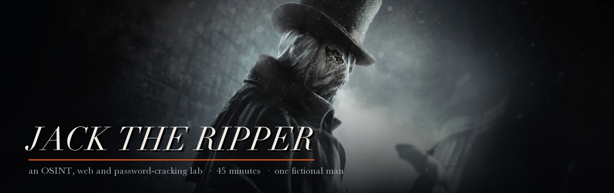

# Jack the Ripper

**A 45-minute red team lab.**

You are not going to need any prior security knowledge. You are not going to need to
install anything beyond Python, which you already have. What you *are* going to need is
patience, and a willingness to look at things properly rather than glance at them.

---

## ⚠️ Rules of engagement — read this first

- **Jack Ripsley does not exist.** He is fictional. His name, his school, his employer, his
  email address and his face are all invented — the photograph of him is AI-generated and
  is not a real human being.
- **Everything you need is inside this repository.** Do not search the public internet for
  Jack Ripsley. There is nothing there, and anyone you *do* find is an unrelated real
  person who did not sign up for this.
- **Do not point any of this at anything you do not own.** Everything you are about to do
  is legal here because it is our lab, our fictional person, and you have explicit
  permission. The same actions against a real person or a system you do not own are a
  crime in most of the world, Sri Lanka included.

The technique is not what makes someone a security engineer. Permission is.

---

## House rules

You are cloning the whole lab, which means the source code of the target is sitting right
there on your disk. Obviously.

> **Do not grep the repository for flags. Do not read `stashbox/app.py` until the debrief.**

Everything is findable the honest way, from the outside, in the time available. Reading
the answer key is not a shortcut — it just means you spent forty-five minutes learning
nothing. We will read the source together at the end, once it can teach you something.

---

## Setup

Two servers, two terminal tabs. Nothing to install.

```bash
git clone https://github.com/O-sura/jack-the-ripper.git
cd jack-the-ripper
```

**Terminal 1 — Jack's corner of the internet**

```bash
cd site
python3 -m http.server 8000
```

**Terminal 2 — Stashbox, the file storage service he uses**

```bash
cd stashbox
python3 app.py
```

| | |
|---|---|
| Jack's website | <http://localhost:8000> |
| Stashbox | <http://localhost:8080> |

*On Windows* the command is usually `python` rather than `python3`. If neither works,
you do not have Python on your PATH — say so and we will sort it out in thirty seconds.
Python 3.8 or newer; nothing else is required.

Stashbox keeps everything in memory. **Restart it and the whole thing resets**, which is
also how you undo any mess you make.

*Port already in use?* Something else is on it — `PORT=9000 python3 app.py`, or find the
culprit with `lsof -nP -iTCP:8080 -sTCP:LISTEN`.

---

## The brief

Jack Ripsley is a backend engineer. He is careful in the way that people who are *slightly*
technical are careful: he has opinions about password managers, he distrusts the cloud, and
he has built himself a system he is quietly pleased with.

He is also a person who has been on the internet for fifteen years, and the internet keeps
everything.

Somewhere in what he has published is enough to get into his account. From there, enough to
reach things that are not his. And somewhere at the end of it is a file he thought was
safe, protected by a password he never had to write down — because he could always generate
it again.

**There are four flags.** They all look like `UOM{...}`.

| # | Objective | Where you're working |
|---|---|---|
| 1 | Work out who Jack is. Something he published is less private than he thinks. | his website |
| 2 | Get into his Stashbox account. You will not guess his password — you won't have to. | Stashbox |
| 3 | Stashbox has other users. You are not supposed to be able to read their files. | Stashbox |
| 4 | He is proud of a script he wrote. Find out why he shouldn't be. | both |

They unlock roughly in order. If you are stuck on one, the thing you are missing is
usually on the *previous* one.

### Things worth remembering

- A web page shows you what it wants to show you. **View the source.** Look at what the
  images are actually called. Read the parts nobody was supposed to read.
- Photographs remember more than the person who took them intended.
- A website that asks you a question to prove who you are has decided that the answer is a
  secret. It is worth checking whether it actually is.
- If something in a URL looks like it identifies one particular thing, it probably
  identifies the others too.
- "Random" is a much stronger claim than most code can support.

---

## Reporting what you find

Finding it is half the job. In real work, a finding that isn't written down clearly enough
for somebody else to reproduce and fix is worth almost nothing.

Copy `REPORT-TEMPLATE.md`, fill it in as you go, and be ready to walk us through one of
your findings at the end.

For each flag, record five things:

1. **The flag** — paste it exactly
2. **Where** — the exact URL, file or page
3. **How** — the steps, briefly, so someone else could repeat them
4. **The weakness** — what was actually wrong? Not "I found a flag" but "this page trusted
   something it should not have"
5. **Severity, and why** — Low / Medium / High / Critical, in your own judgement

Then one line at the end: **how would you fix it?**

Severity is the one people skip. Don't. Deciding *how bad* something is, and defending that
judgement, is most of the job — and you will notice that two of these findings are much
more serious than the other two.

---

## If you get completely stuck

Ask. There are no points for suffering in silence, and the person running this session has
a list of nudges that start gentle and end with simply telling you.

Forty-five minutes is not very long. Move fast, write things down, and when something feels
slightly odd — that is the feeling. Follow it.

---

<sub>Banner artwork from *Assassin's Creed Syndicate* — "Jack the Ripper" © Ubisoft
Entertainment. Not affiliated with or endorsed by Ubisoft ;).</sub>
